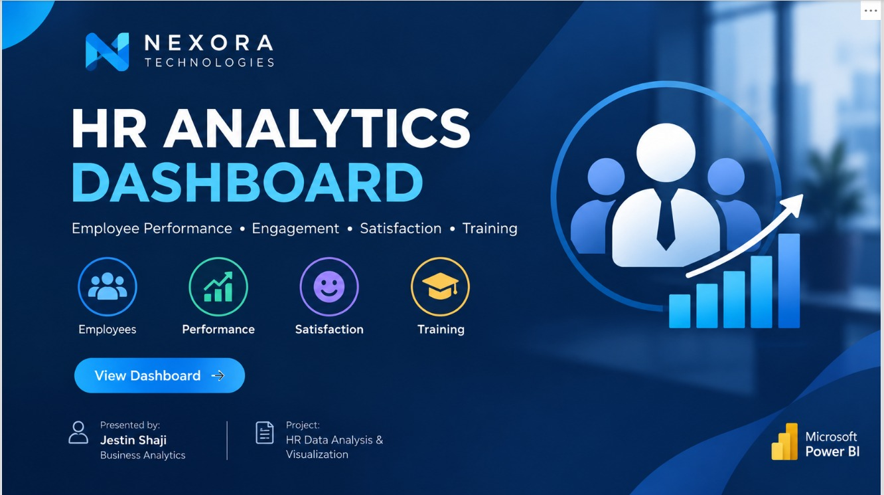

# 📊 HR Analytics Dashboard | Power BI

Welcome to my **HR Analytics Dashboard Project!** 👋

This project uses Microsoft Power BI to explore HR data, analyze employee performance and satisfaction, and understand workforce trends through interactive visualizations.

## 🎯 Project Objectives

- 👥 Analyze employee and workforce information.
- ⭐ Explore employee performance and satisfaction ratings.
- ⚖️ Examine work-life balance across employee types.
- 📚 Analyze training programs and their outcomes.
- 📈 Present HR metrics through interactive dashboards.

## 🛠️ Tools & Technologies

- 📊 Microsoft Power BI
- 🔄 Power Query
- 🧮 DAX, where applicable
- 📁 CSV dataset
- 📈 Data visualization

## 🖼️ Dashboard Preview

### 🏢 Project Introduction

### 📊 Dashboard — Page 1

### 📈 Dashboard — Page 2

## 📂 Project Files

- `hr dataset new dashboard 3.0.pbip` — Power BI project file.
- `Cleaned_HR_Data_Analysis (1).csv` — cleaned dataset.
- `Introduction.jpeg` — project introduction.
- `1st Page.jpeg` — first dashboard page.
- `2nd Page.jpeg` — second dashboard page.

## 💡 Key Learnings

- Data preparation and cleaning.
- HR metrics analysis.
- Dashboard design and visualization.
- Presenting data-driven insights.

## 🏁 Conclusion

This project demonstrates how HR data can be transformed into meaningful visual insights to explore employee performance, satisfaction, work-life balance, and training outcomes.

👨‍💻 **Created by: Jestin Shaji**

🔗 [GitHub Profile](https://github.com/jestinshaji2004)
